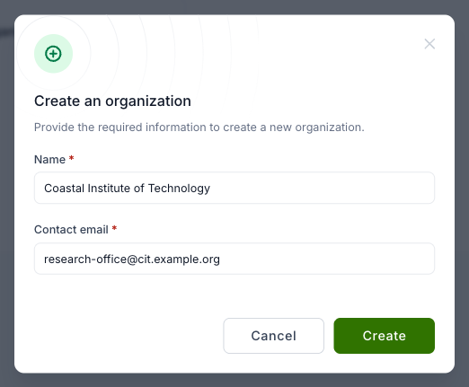
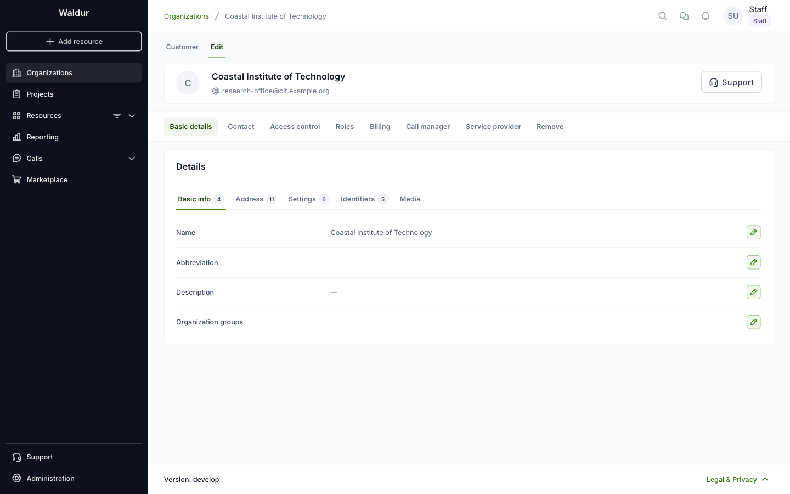
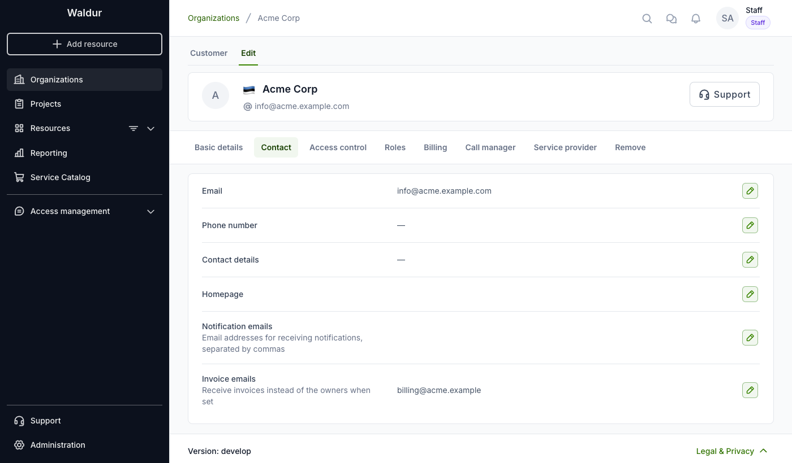
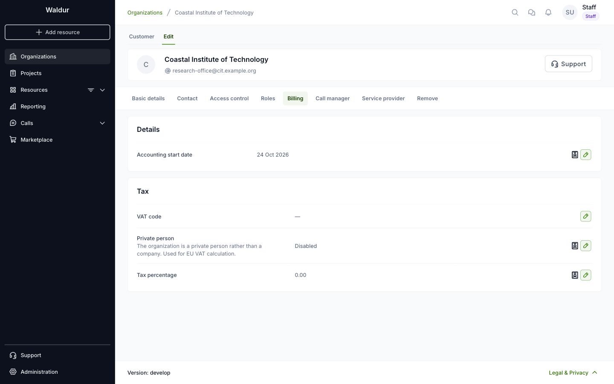
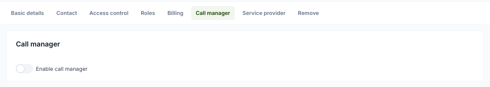
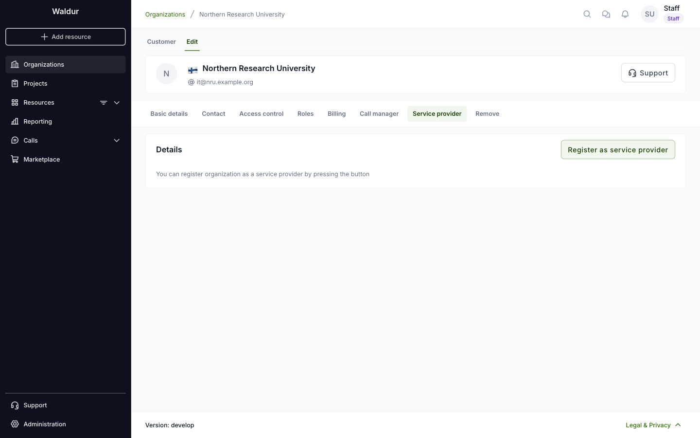
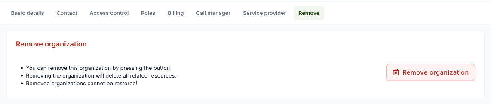

# Organization management

## Overview

In Waldur, an organization represents a configurable grouping unit that can be adapted to various contexts such as research groups, institutions, departments, or working groups. Each organization has an designated owner who manages the organization's projects, users, and associated resources.

## Create a new organization

!!! note
    Organization creation is only allowed for users in Staff role!

1. Select **Organizations** in the sidebar and click **Add**.
2. Enter the organization's **Name** and a **Contact email**, the address of the person
   responsible for the organization, and click **Create**.

    

3. The organization's **Edit** tab opens, where you can add more information, such as the
   address, contact details and billing settings. It is beneficial to assign a predefined
   organization group (like private company, university, government, individual person etc) to
   the organization.

!!! Note
    After the creation of the organization by the staff user, organization owners can manage organization details. To do this, navigate to the organization dashboard and select **Edit**.

## Organization configuration

The organization edit interface consists of these tabs, each containing specific configuration
options: **Basic details**, **Contact**, **Access control**, **Roles**, **Billing**, **Call
manager**, **Service provider** and **Remove**.

### Basic details

The **Details** card is split into sub-tabs.

#### Basic info

- **Name** - Full organization name
- **Abbreviation** - Short form of organization name
- **Description** - Free-text description
- **Organization groups** - Associated group categories

#### Address

Country, city, state, parish, street, house number, postal code, apartment number,
household and geographic location.

#### Settings

- **Maximum number of service accounts**
- **Default grace period (days)** - applied to projects that do not set their own, see
  [Grace period](../customer-organization/project-management.md#grace-period)
- **Available affiliations** - affiliations offered to project creators in this organization
- **Display billing info in projects**
- **Project slug template** - how slugs of new projects are built
- **Project metadata schema** - the checklist used to collect project metadata

#### Identifiers

- **UUID** - System-generated unique identifier (non-editable)
- **Slug** - URL-friendly identifier; changing it may break external integrations
- **Registration code** - Official registration number
- **Agreement number** - Contract reference number
- **Sponsor number** - Sponsorship identifier

#### Media

The organization's logo.



### Contact information

- **Email** - Primary contact email
- **Phone number** - Contact telephone
- **Contact details** - Additional contact information
- **Homepage** - Organization's website
- **Notification emails** - Additional addresses for organization notifications, separated by commas
- **Invoice emails** - Addresses that receive the organization's invoices, separated by commas



#### Invoice recipients

Monthly invoice emails, with the invoice attached as a PDF, go to the organization owners by default.
When **Invoice emails** is set, they go to those addresses instead, and the owners no longer receive them.
The same addresses receive the notice that a fixed-price contract is about to end. Clear the field to send
invoices to the owners again.

Whenever the list changes, the owners are emailed the old and new recipients and the name of the person who
made the change, so invoices cannot be redirected unnoticed.

!!! note
    Like every Waldur notification, both emails are disabled until an operator enables them. With the Helm
    chart, list them under `waldur.notifications`:

    ```yaml
    waldur:
      notifications:
        invoices.notification: true
        invoices.invoice_emails_changed: true
    ```

    Enable `invoices.invoice_emails_changed` whenever `invoices.notification` is enabled; otherwise invoice
    recipients can be changed without the owners being told.

The field is shown where the deployment emails invoices automatically, which operators enable with the
`send_customer_invoices` feature of the Helm chart. Staff always see it, because they can send an invoice
by hand from the invoice page. A list that is already set stays visible to everyone who can edit the
contact information, so it can always be reviewed and cleared.

### Access control

**Access subnets** lists the organization's trusted networks: address ranges (CIDR) with a
description, each trusted for signing in to the portal and/or reaching the organization's
resources of particular offerings, see
[Access subnets](../customer-organization/resource-access-subnets.md). **Membership
restrictions** limits who can become a member: when restrictions are configured, only users
that match at least one of them can join the organization.

### Roles

Lists the roles available in the organization. Staff users can clone a system role into the
organization and adjust it, see [Organization-scoped roles](organization-roles.md).

### Billing

Contains billing-related configurations:

- **Accounting start date** - the date billing starts for the organization
- **VAT code**, **Private person** and **Tax percentage** - tax information used on invoices



### Call manager

You can make the organization a call manager, which lets it run calls for proposals, by
switching on **Enable call manager**.



### Service provider

You can register organization as a service provider by pressing **Register as service
provider**, see [Service provider registration](../service-provider-organization/service-provider-registration.md).



### Remove

Click **Remove organization** to delete the organization. Removing it deletes all related
resources, and a removed organization cannot be restored.



!!! note
    Organization removal should be handled with caution as it may affect associated projects and users. Ensure all necessary data is backed up before proceeding with organization removal.
