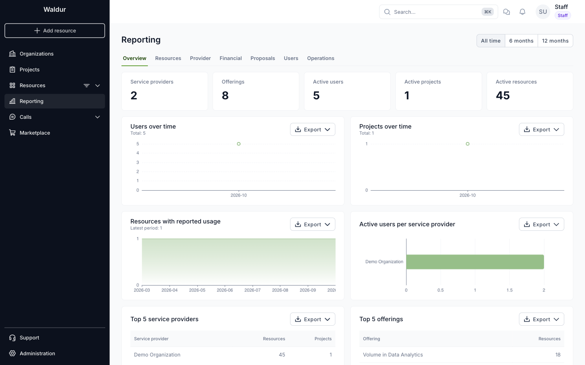
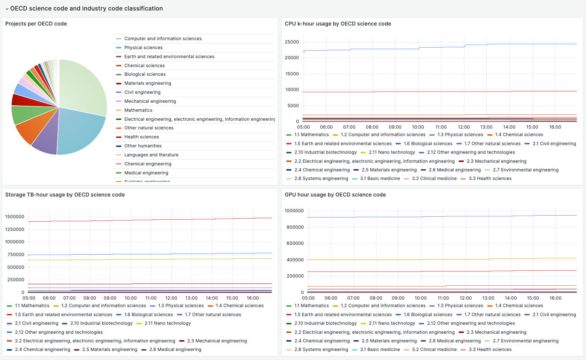

# Reporting

## HomePort reports

Waldur HomePort includes a number of built-in reports based on the user activity. Reports can be accessed by
staff and support users from the **Reporting** sidebar menu.

The **Overview** tab shows the number of service providers, offerings, active users, projects and
resources, with charts of their growth. The buttons in the top right corner set the period: all
time, 6 months or 12 months. The other tabs group the reports by topic:

- **Resources** — usage, usage by user and organization quotas.
- **Provider** — capacity of offering plans, a provider overview and provider revenue.
- **Financial** — growth, monthly revenue by organization and offering costs.
- **Proposals** — call performance, review progress and resource demand of calls for proposals.
- **Users** — demographics, user analytics and affiliations.
- **Operations** — orders, maintenance and provisioning statistics.

Each chart has an **Export** menu to download its data.

<figure markdown="span">
  
  <figcaption>Overview tab of the Reporting menu</figcaption>
</figure>

## Reports for organization owners

An administrator can enable the `customer.show_organisation_reporting` feature flag, which gives
**organization owners** their own Reporting menu scoped to the organizations they own. The menu lists
only the reports that make sense for a single organization:

- **Organization summary** — the organization's resources by project, with limits and usage.
- **Quotas** — resource count, estimated cost and cloud quota usage.
- **Usage** — component-level usage per resource over a period.
- **Usage by user** — component usage attributed to individual team members.
- **Project detail** — resource limit and usage history of one project.

An owner picks the organization to report on from a selector on the reporting pages. Organization
managers are not included: only owners see the menu. Staff and support users keep the full report list,
and the flag does not change what they see.

## Grafana and Prometheus Metrics

Waldur supports exporters to Prometheus of different statistical metrics that can be used for building
business dashboards, for example, in Grafana.

Check out details about the [setup of the exporter](../../admin-guide/grafana.md).

<figure markdown="span">
  
  <figcaption>Example of OECD-science code report</figcaption>
</figure>

## Custom reports

It is possible to implement custom metric collection and report generation using Waldur SDK. Several examples are
provided in [the section for integrators](../../integrator-guide/reporting.md).
